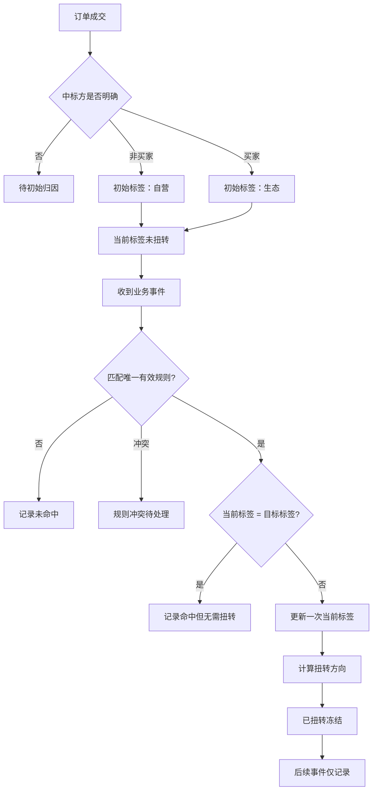

# 订单标签与部门扭转规则产品方案

> 状态：评审草案，不可作为研发执行依据
> 适用范围：订单初始标签、部门扭转触发配置、首次更新与冻结、追溯
> 文档性质：补充范围方案草案，不替代 Gate 审批

## 文档信息

| 字段 | 内容 |
| --- | --- |
| 需求 ID | `REQ-20261114-001` |
| 项目台账 | `req-20261114-001-recycle-type-rule-config` |
| 方案版本 | `v0.3` |
| 更新时间 | 2026-11-20 |
| 状态 | 评审草案 |
| 关联事实 | `F-001`、`F-003`、`F-007`、`F-009`、`F-010`、`F-011`、`F-012`、`F-013` |
| 关联决策 | `D-003`、`D-005`、`D-006`、`D-007`、`D-008`、`D-009`、`D-010`、`D-011` |
| 关联假设 | `A-001` |
| 待确认项 | 无 |
| Gate | 原标签治理范围已通过 G1；本补充范围待确认，G2 尚未通过 |

本方案解决“成交后如何生成订单标签、什么条件允许扭转、扭转后何时停止更新”三个问题。方案只负责订单标签写入和更新，不建设报表、统计看板或历史重分类。方案不把部门扭转解释为货物实物流转，也不通过渠道名称、手机号或机器人名称反推部门。

## 1. 背景与问题

### 1.1 已确认事实

- 自营部门通过闪回成交获取订单，生态部门通过买家成交获取订单，两类成交流程和工具不同。
- 当前两个部门各自生成标签，标签名称、含义、更新时机和统计口径存在混乱。
- 订单初始标签只有“自营”和“生态”两个值。
- 非买家中标订单判断为自营，买家中标订单判断为生态。
- 部门扭转不是实物流，而是在指定业务节点由渠道、手机号、机器人、售后退货或售前退货/取消等条件触发。
- 每条扭转触发配置可以关联一个目标标签。
- 订单成交时写入一个标签，命中扭转规则后最多更新一次，更新后标签冻结。
- 本需求不处理报表；系统完成标签更新后，由各部门按统一标签自行拉取订单数据。

### 1.2 真正需要解决的问题

如果一个字段同时承担以下职责，订单归属就无法稳定解释：

1. 记录成交时订单应计入自营还是生态；
2. 判断该订单由买家还是非买家中标；
3. 记录后续渠道、手机号、机器人或售后事件；
4. 决定是否发生部门扭转；
5. 表示扭转后的最终标签；
6. 向各部门输出一致、可追溯的标签结果。

本方案将上述职责拆成事实、配置、执行结果和事件记录四层，确保同一订单在任一时刻只有一个当前标签，且该标签最多更新一次。

## 2. 目标与成功标准

### 2.1 业务目标

- 所有新成交订单都能按统一规则生成自营或生态初始标签。
- 业务人员可以通过配置指定触发条件关联的目标标签，无需开发逐条写死规则。
- 订单命中首次跨部门规则的节点、规则版本和前后标签均可追溯。
- 标签冻结后不会被后续事件再次修改。
- 系统只输出统一标签，各部门可基于同一标签字段自行取数。

### 2.2 成功衡量

当前没有可引用的业务基线，以下指标先建立数据采集口径，目标值由业务与数据负责人确认：

| 指标 | 定义 |
| --- | --- |
| 初始标签覆盖率 | 有明确中标事实、成功生成初始标签的新订单占比 |
| 待归因订单数 | 中标方缺失或规则冲突导致无法生成/扭转标签的订单数 |
| 扭转追溯完整率 | 已扭转订单中同时具备前后标签、事件、规则版本和生效时间的占比 |
| 重复更新数 | 已冻结订单发生第二次标签更新的数量，目标应为 0 |
| 规则冲突数 | 同一业务节点命中不同标签且未配置优先级的订单数 |
| 标签取数一致性 | 不同部门拉取同一订单时获得一致初始标签和当前标签的占比 |

不得在没有基线时给出精确目标百分比。目标值应在影子计算和试点对账后确定。

## 3. 本期范围

### 3.1 P0 业务结果

1. **订单初始标签可稳定生成**
   - 非买家中标订单生成“自营”。
   - 买家中标订单生成“生态”。
   - 中标方缺失时不猜测，进入待归因。

2. **首次跨部门扭转只更新一次**
   - 触发配置命中后，比较订单当前标签与配置关联的目标标签。
   - 两者不同才更新标签并冻结。
   - 冻结后所有后续触发仅留痕，不再更新标签。

3. **订单标签全过程可解释**
   - 可查看初始标签、当前标签、扭转方向、首次扭转事件和规则版本。
   - 未扭转、已扭转冻结、待归因和冲突状态可区分。

4. **统一输出标签字段**
   - 订单数据同时包含初始标签、当前标签、更新状态和扭转方向。
   - 系统不生成部门报表或汇总统计。
   - 各部门按统一字段自行拉取订单数据。

### 3.2 P1 可后续纳入

- 规则发布前试算。
- 触发规则影响范围预估。
- 异常订单批量重算申请。
- 面向部门取数的字段说明和数据字典。

### 3.3 本期不做

- 不把部门扭转解释为货物实物流转或物权变更。
- 不允许一个订单存在多个当前标签。
- 不在首次扭转后继续按后续事件更新标签。
- 不允许运营直接修改订单标签。
- 不通过渠道名称、手机号或机器人名称推断目标部门。
- 不预设五类触发条件各自固定对应某个目标标签。
- 不在首期自动重算全部历史订单。
- 不处理跨部门自动分成、结算或资金拆分。
- 不建设报表、统计看板、部门汇总视图或历史月报重分类。
- 不定义各部门报表的统计时间和聚合方式。

## 4. 核心概念

### 4.1 两层标签

| 字段 | 取值 | 写入时点 | 是否可变 | 用途 |
| --- | --- | --- | --- | --- |
| 初始标签 | 自营 / 生态 | 订单成交 | 不可变 | 证明成交时的归属判断 |
| 当前标签 | 自营 / 生态 | 成交时初始化，首次扭转时更新一次 | 最多变化一次 | 当前订单归属标签 |

当前标签初始等于初始标签。除经审批的异常修复外，不允许人工直接修改。

### 4.2 判断依据

“买家中标订单”和“非买家中标订单”是初始标签的判断依据，不是初始标签值。

| 中标事实 | 初始标签 |
| --- | --- |
| 非买家中标订单 | 自营 |
| 买家中标订单 | 生态 |
| 中标方缺失 | 不生成，进入待归因 |

### 4.3 扭转配置

触发条件与目标标签是配置关系，不是固定字典关系。同一个触发类型在不同规则下可以关联不同目标标签。

| 配置项 | 要求 |
| --- | --- |
| 规则 ID | 全局唯一 |
| 触发类型 | 指定渠道成交、指定手机号成交、指定机器人成交、买家售后退货、买家售前退货/取消 |
| 匹配对象 | 具体渠道 ID、手机号标识、机器人 ID，或对应业务事件 |
| 触发节点 | 该条件在哪个业务时点参与判断 |
| 配置标签 | 触发规则命中后关联的指定标签 |
| 执行优先级 | 同一节点多条规则命中时的选择依据 |
| 生效时间 | 规则开始参与判断的时间 |
| 状态 | 草稿、待审核、生效中、已停用 |
| 版本 | 每次发布形成新版本 |

触发条件不固定对应自营或生态，而是在每条规则中关联一个指定标签。本方案暂将“配置标签”解释为与初始标签、当前标签同一字段域的“自营 / 生态”标签，见 `A-001`。如果业务实际允许关联机器人、企业购等业务分类，应新增独立字段，不能覆盖订单归属标签。

### 4.4 五类触发条件的业务定义

| 触发类型 | 匹配对象 | 触发节点 | 标签处理 |
| --- | --- | --- | --- |
| 指定渠道成交 | 具体渠道 ID | 渠道成交订单生成后 | 该渠道订单自动标记为规则配置标签，不区分中标方 |
| 指定机器人成交 | 具体机器人 ID | 该机器人中标时 | 自动标记为规则配置标签 |
| 指定手机号成交 | 具体手机号标识 | 该手机号中标时 | 自动标记为规则配置标签 |
| 买家售后退货 | 买家发起的售后退货 | 售后审核通过并完成退货 | 已成交订单标签理论上保持生态，不产生新的扭转 |
| 买家售前退货/取消 | 买家成交后的取消转闪回成交 | 付款状态为已付款且取消转闪回成交后 | 已成交订单标签理论上保持生态，不产生新的扭转 |

### 4.5 扭转方向

| 更新前标签 | 关联目标标签 | 结果 |
| --- | --- | --- |
| 自营 | 生态 | 当前标签更新为生态，方向为“自营转生态” |
| 生态 | 自营 | 当前标签更新为自营，方向为“生态转自营” |
| 自营 | 自营 | 未发生扭转，不更新 |
| 生态 | 生态 | 未发生扭转，不更新 |

## 5. 核心业务规则

### 5.1 成交初始化

```text
订单成交
  → 读取中标方
  → 非买家：初始标签 = 自营
  → 买家：初始标签 = 生态
  → 当前标签 = 初始标签
  → 标签状态 = 未扭转
  → 保存成交事件 ID、判断依据和规则版本
```

中标方缺失时：

```text
订单成交
  → 不生成初始标签
  → 标签状态 = 待初始归因
  → 保存缺失原因
  → 不影响订单成交主流程
```

### 5.2 触发判断

收到渠道、手机号、机器人、售后退货或售前退货/取消事件后，按以下顺序处理：

```text
收到有效业务事件
  → 校验事件幂等键
  → 校验订单存在初始标签
  → 若标签已冻结：只记录事件，不更新标签
  → 获取触发节点生效的规则版本
  → 匹配指定渠道 / 手机号 / 机器人 / 售后 / 取消条件
  → 选出唯一命中规则
  → 比较当前标签与规则目标标签
  → 不同：更新一次并冻结
  → 相同：记录“命中但无需扭转”，不冻结
```

### 5.3 冻结规则

- 只有“当前标签与目标标签不同”的首次更新才会触发冻结。
- 命中规则但与当前标签相同，不构成部门扭转，订单可以继续等待后续有效触发。
- 买家售后退货和买家售前退货/取消属于标签保护型触发：完成事件后应继续保持生态；若当前标签不是生态，则记录异常并进入核查。
- 冻结后 `当前标签`、`初始标签` 和 `扭转方向` 均不可被业务事件再次修改。
- 后续渠道、手机号、机器人、售后退货和售前取消事件仍进入事件流水，状态标记为“已冻结，不更新”。
- 经审批的异常修复不改变业务规则本身，只生成独立修复记录和标签新版本。

### 5.4 多规则命中与优先级

优先级规则按成交渠道、机器人、手机号和售后事件分别处理：

| 规则层级 | 业务规则 |
| --- | --- |
| 渠道最高优先级 | 订单命中指定渠道规则时，渠道规则强制执行并覆盖中标方判断 |
| 机器人 / 手机号 | 两者均按“中标方匹配”触发，业务上同一个订单只有一个成交方，因此不设置互相之间的优先级 |
| 售后事件 | 只校验买家售后退货或售前退货/取消后的生态标签，不参与渠道、机器人和手机号的扭转竞争 |

执行规则：

- 指定渠道、指定机器人或指定手机号规则命中时，直接把订单标记为规则关联的配置标签。
- 渠道规则不判断中标方；即使订单同时命中机器人或手机号规则，也以渠道配置标签为准。
- 机器人和手机号按实际成交方匹配；正常情况下一个订单不会同时命中两条不同成交方规则。
- 如果数据异常导致机器人与手机号规则同时命中且配置标签不同，停止自动更新并进入规则冲突队列。
- 同一个具体渠道、机器人或手机号只能存在一个生效的配置标签；重复配置在发布时阻断。
- 不同业务时点先后到达时，以第一个已生效并产生标签更新的事件为准。
- 重复事件按幂等键去重，不产生新的标签版本。
- 晚到事件不得覆盖已经产生的首次标签更新；若晚到事件业务时间更早，应记录冲突并进入核查。

### 5.5 版本控制

- 订单使用业务事件生效时间对应的规则版本。
- 规则更新只影响生效后的新事件，不追溯改写已冻结订单。
- 每次标签更新保存规则 ID、规则版本、事件 ID、事件生效时间和处理时间。
- 规则停用不删除历史版本。

## 6. 状态设计

| 状态 | 进入条件 | 是否可更新当前标签 | 后续处理 |
| --- | --- | --- | --- |
| 待初始归因 | 订单已成交但中标方缺失 | 否 | 补正式中标事实后生成初始标签 |
| 未扭转 | 当前标签已生成，尚未发生跨部门更新 | 是 | 等待有效触发 |
| 已扭转冻结 | 当前标签与目标标签不同，首次更新成功 | 否 | 后续只记录事件 |
| 规则冲突待处理 | 同一节点命中不同目标标签且无优先级 | 否 | 业务核查后补规则或人工审批修复 |
| 异常待修复 | 标签处理失败、事件异常或历史数据不一致 | 否 | 审批后执行修复 |

流程图：



## 7. 数据模型建议

### 7.1 订单标签快照

| 字段 | 说明 |
| --- | --- |
| `order_id` | 订单唯一标识，原型和日志中脱敏 |
| `bidder_type` | 买家、非买家 |
| `initial_label` | 自营、生态 |
| `current_label` | 自营、生态 |
| `label_status` | 待初始归因、未扭转、已扭转冻结、冲突、异常 |
| `twist_direction` | 无、自营转生态、生态转自营 |
| `initial_event_id` | 生成初始标签的成交事件 |
| `twist_event_id` | 首次扭转事件 |
| `matched_rule_id` | 命中的触发规则 |
| `matched_rule_version` | 规则版本 |
| `effective_at` | 扭转事件业务生效时间 |
| `frozen_at` | 标签冻结时间 |
| `version` | 订单标签快照版本 |

### 7.2 扭转触发记录

| 字段 | 说明 |
| --- | --- |
| `trigger_id` | 触发记录唯一标识 |
| `order_id` | 关联订单 |
| `trigger_type` | 渠道、手机号、机器人、售后退货、售前取消 |
| `business_node` | 事件所属业务节点 |
| `match_object_id` | 渠道 ID、手机号标识、机器人 ID 或事件类型 |
| `target_label` | 规则关联的目标标签 |
| `rule_id` | 命中规则 |
| `rule_version` | 规则版本 |
| `event_id` | 业务事件 ID |
| `idempotency_key` | 幂等键 |
| `handled_result` | 更新成功、无需扭转、已冻结、未命中、冲突、失败 |
| `before_label` | 处理前标签 |
| `after_label` | 处理后标签 |
| `occurred_at` | 业务发生时间 |
| `handled_at` | 系统处理时间 |

### 7.3 规则配置

规则必须使用稳定 ID 匹配，不依赖展示名称：

- 渠道使用渠道 ID；
- 手机号使用脱敏展示和历史稳定标识，不在页面或日志中展示完整号码；
- 机器人使用机器人 ID；
- 售后退货和售前取消使用受控事件类型及正式事件 ID；
- 目标标签使用受控枚举；
- 规则每次发布形成不可覆盖的版本。

## 8. 页面与交互

### 8.1 扭转规则列表

展示：

- 规则名称和规则 ID；
- 触发类型；
- 匹配对象摘要；
- 触发节点；
- 目标标签；
- 优先级；
- 状态、版本、生效时间。

操作：

- 新建、编辑草稿、提交审核、停用；
- 查看版本和审核记录；
- 按触发类型、目标标签和状态筛选。

### 8.2 扭转规则编辑

必填信息：

- 触发类型；
- 匹配对象；
- 触发节点；
- 目标标签；
- 优先级；
- 生效时间。

校验：

- 同一生效期内，同一触发对象、同一节点关联不同目标标签时必须提供不同优先级；
- 未配置优先级时阻止发布；
- 目标标签只能从自营、生态中选择；
- 手机号必须脱敏展示；
- 规则必须有责任部门和审核人。

### 8.3 订单标签详情

展示：

- 订单号；
- 初始标签及判断依据；
- 当前标签；
- 标签状态；
- 扭转方向；
- 首次扭转事件、规则和版本；
- 事件时间线；
- 冻结时间；
- 后续被忽略的触发记录。

订单标签详情只读。异常修复通过独立审批流程执行。

### 8.4 待归因与冲突队列

按以下原因分类：

- 中标方缺失；
- 规则冲突；
- 事件来源缺失；
- 重复或晚到事件；
- 历史订单字段不完整；
- 标签处理失败。

队列显示影响订单数、首次发生时间、最近发生时间和责任部门。首期不提供无审批的批量改标签。

### 8.5 数据输出与消费边界

系统输出以下订单标签字段，供各部门自行拉取：

- 订单号；
- 初始标签；
- 当前标签；
- 标签状态；
- 扭转方向；
- 首次更新事件及生效时间；
- 命中规则及规则版本。

系统只保证这些字段按统一规则生成并可追溯，不提供部门报表。各部门负责自己的取数范围、汇总方式和报表展示，不能自行改写订单标签来判断归属。

## 9. 角色与权限

| 角色 | 查看 | 配置规则 | 审核规则 | 修改订单标签 | 发起修复 | 拉取订单数据 |
| --- | --- | --- | --- | --- | --- | --- |
| 自营配置人 | 是 | 自营规则草稿 | 否 | 否 | 否 | 自营数据范围 |
| 生态配置人 | 是 | 生态规则草稿 | 否 | 否 | 否 | 生态数据范围 |
| 自营审核人 | 是 | 否 | 自营规则 | 否 | 否 | 自营数据范围 |
| 生态审核人 | 是 | 否 | 生态规则 | 否 | 否 | 生态数据范围 |
| 运营异常处理人 | 涉及订单 | 否 | 否 | 否 | 按权限 | 按权限 |
| 数据人员 | 是 | 否 | 否 | 否 | 否 | 按授权 |
| 平台管理员 | 是 | 全局配置维护 | 不能替代部门审核 | 否 | 按权限 | 按授权 |

约束：

- 提交人不得审核本人提交的规则。
- 自营规则由自营审核人确认，生态规则由生态审核人确认。
- 平台管理员不能替代部门审核结论。
- 所有新建、修改、发布、停用、修复和重算写入审计流水。

## 10. 报表与历史数据边界

- 系统不生成订单归属报表、部门统计看板或自动汇总。
- 系统不负责历史月报重分类。
- 标签更新后，各部门按统一字段自行拉取最新订单数据，并自行处理统计周期。
- 系统保留初始标签、当前标签、事件生效时间和规则版本，供部门核对同一订单的标签来源。
- 不得由各部门自行修改底层订单标签来调整统计；存在业务差异时通过规则审核或异常修复流程处理。

## 11. 异常与边界

| 场景 | 系统处理 | 用户可见结果 |
| --- | --- | --- |
| 中标方缺失 | 不猜默认标签，进入待初始归因 | 显示“中标方待补” |
| 同一事件重复到达 | 按幂等键去重 | 只保留一条有效处理记录 |
| 命中规则但目标标签相同 | 记录“无需扭转”，不冻结 | 当前标签不变 |
| 标签已冻结后再次命中 | 仅记录事件 | 显示“已冻结，不更新” |
| 同一节点多规则冲突 | 当前标签不变，进入待处理 | 显示冲突规则和目标标签 |
| 晚到事件早于已完成扭转 | 不覆盖当前标签，进入核查 | 显示事件时间冲突 |
| 标签服务失败 | 订单成交不受影响，任务重试 | 显示“标签处理失败” |
| 规则生效后停用 | 新事件不再命中；历史已执行结果保留 | 规则和订单均显示历史版本 |
| 渠道、手机号或机器人不存在 | 不模糊匹配 | 显示匹配对象无效 |
| 历史订单无新字段 | 保持原标签，不自动回填 | 标记“历史未归因” |

## 12. 迁移与发布

### 12.1 数据迁移

- 新订单按新规则生成初始标签。
- 存量订单保留原标签，不自动改写。
- 需要补算的存量订单必须明确范围、规则版本、受影响部门和回滚方式。
- 手机号等个人信息按最小必要原则保存和展示。
- 历史标签保留规则版本和变更时间，供各部门取数时识别。

### 12.2 发布步骤

1. 建立规则配置和订单标签快照能力。
2. 对灰度订单执行影子计算，不直接改写正式订单标签。
3. 对比旧标签、新初始标签、命中规则和待归因结果。
4. 由自营、生态和数据负责人确认差异原因。
5. 小范围启用首次扭转更新和冻结。
6. 核对无重复更新、标签字段一致和事件追溯完整后扩大范围。
7. 达到业务确认的稳定性标准后启用正式标签更新。

### 12.3 停止与回滚信号

出现以下情况时停止扩大范围，保留事件记录并回退到只读或旧口径：

- 已冻结订单发生第二次标签更新；
- 规则冲突导致无法解释订单归属；
- 晚到事件大面积覆盖已有标签；
- 渠道、手机号或机器人匹配出现明显误判；
- 部门拉取同一订单时获得不一致的初始标签或当前标签。

具体阈值由业务、数据和技术负责人在试点前共同确认，不在本草案中编造比例。

## 13. 方案验收场景

| 编号 | 场景 | 前置条件 | 预期结果 |
| --- | --- | --- | --- |
| `AC-01` | 非买家中标成交 | 中标方明确为非买家 | 初始标签和当前标签均为自营 |
| `AC-02` | 买家中标成交 | 中标方明确为买家 | 初始标签和当前标签均为生态 |
| `AC-03` | 中标方缺失 | 无正式中标事实 | 生成待归因记录，不猜标签 |
| `AC-04` | 渠道规则覆盖中标判断 | 订单中标方为买家，但渠道关联标签为自营 | 更新为自营，渠道规则优先 |
| `AC-05` | 机器人规则 | 指定机器人中标 | 更新为机器人规则关联的配置标签 |
| `AC-06` | 手机号规则 | 指定手机号中标 | 更新为手机号规则关联的配置标签 |
| `AC-07` | 标签相同 | 当前标签与规则配置标签相同 | 记录命中但无需更新，不冻结 |
| `AC-08` | 冻结后再次触发 | 订单已完成首次跨部门更新 | 记录事件，不再更新标签 |
| `AC-09` | 渠道与机器人同时命中 | 渠道和机器人规则关联不同标签 | 渠道标签生效 |
| `AC-10` | 机器人与手机号异常同时命中 | 两方规则关联不同标签 | 不自动更新，进入冲突队列 |
| `AC-11` | 买家售后退货 | 售后审核通过并完成退货 | 标签保持生态，不产生新的扭转 |
| `AC-12` | 买家售前退货/取消 | 付款状态为已付款，取消转闪回成交 | 标签保持生态，不产生新的扭转 |
| `AC-13` | 重复事件 | 同一幂等键再次到达 | 不产生重复标签版本 |
| `AC-14` | 追溯完整 | 订单发生首次标签更新 | 可查看初始值、当前值、事件和规则版本 |
| `AC-15` | 部门自行取数 | 自营、生态分别按统一字段拉取订单 | 两端获得一致的初始标签和当前标签 |
| `AC-16` | 通话号码脱敏 | 查看手机号触发规则和审计 | 页面不展示完整手机号 |

本表是产品方案验收口径，不是已执行的正式测试结果。

## 14. 决策、假设与待确认

### 14.1 已确认决策

| ID | 决策 |
| --- | --- |
| `D-003` | 多条规则同时命中时按高优先级胜出；同优先级冲突时禁止发布 |
| `D-005` | 首期人工变更只允许经审批的异常修复或重算 |
| `D-006` | 标签只归属一个部门，提交人与审核人分离 |
| `D-007` | 订单成交写入标签，命中扭转条件后更新一次，此后不再更新 |
| `D-008` | 每条扭转触发配置关联目标标签；目标不同才更新并冻结 |
| `D-009` | 指定渠道规则不区分中标方，命中后自动标记为配置标签，并高于机器人、手机号规则 |
| `D-010` | 机器人、手机号均按中标方匹配；业务上二者互斥，不设置互相之间的优先级 |
| `D-011` | 系统只负责订单标签更新，不处理报表；各部门按统一标签字段自行拉取数据 |

### 14.2 当前假设

| ID | 假设 | 影响 |
| --- | --- | --- |
| `A-001` | 触发配置关联的“指定标签”仅指自营或生态 | 若还包含机器人、企业购等分类，需要新增独立字段 |

### 14.3 待确认项

无。`Q-011` 已由“系统不处理报表、各部门自行拉取数据”的决策关闭。

## 15. Gate 与下一步

当前已通过的 G1 仅覆盖原有统一标签治理范围，不包含本次“成交、首次扭转、冻结”补充规则。本文件为产品方案草案，不能替代 G1 补充范围确认或 G2 方案评审。

下一步：

1. 业务负责人确认 `A-001`：触发配置关联的标签是否只允许自营、生态。
2. 补齐实际渠道 ID、机器人 ID、手机号标识及各自关联标签，形成可发布规则清单。
3. 以上内容确认后，更新 G1 补充范围并进入原型或交互评审。
4. G2 真实评审通过前，不生成最终规格、正式测试用例或研发执行结论。
