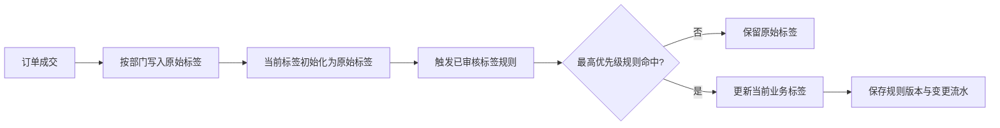

# 统一业务标签配置、审核与自动更新 Proposal

## 文档信息

- 需求 ID：`REQ-20261114-001`
- 项目台账：`req-20261114-001-recycle-type-rule-config`
- 版本：v0.4
- 状态：草案，待 G1 范围确认
- 更新时间：2026-11-19
- Owner：待确认
- 关联事实：F-001 ～ F-007
- 关联决策：D-001 ～ D-005
- 关联材料：<https://alidocs.dingtalk.com/i/nodes/m9bN7RYPWdlyxAGZTRZbrqoMWZd1wyK0>
- 历史方案：`proposal-v0.3-archive.md`

## 一、结论先行

本需求应当建设“统一标签定义 + 标签规则 + 订单执行 + 审核审计”的完整能力，不再由自营、生态两套成交工具各自维护互不一致的标签。

订单标签拆成两个字段：

1. **原始业务标签**：订单成交时按部门确定，永久不可修改。
   - 自营部门：`闪回-闪回成交`
   - 生态部门：`买家-买家成交`
2. **当前业务标签**：用于业务查询、运营分析和报表展示，初始值等于原始业务标签；订单满足已审核生效规则后，更新为对应业务标签。

触发标签更新时，只替换“当前业务标签”，原始业务标签始终保留。一个订单只允许一个当前业务标签；多条规则命中时按最高优先级规则胜出，同优先级冲突禁止发布。

配置调整默认不追溯历史订单，仅影响新订单及后续事件。首期人工调整当前业务标签时，只允许发起经审批的异常修复或规则重算。



## 二、Why：为什么现在做

### 2.1 业务问题

- 自营和生态两个部门获取成交订单的工具及业务路径不同。
- 各部门工具直接生成标签，标签名称、含义和更新条件缺少统一定义。
- 业务人员难以判断同一订单为什么出现不同标签，报表和监控口径容易混淆。
- 原始成交类型与后续业务归类混在一个可修改字段中，无法稳定追溯。

### 2.2 业务目标

- 建立两个部门共用的业务标签定义和配置入口。
- 通过审核保证标签名称、适用部门和规则口径一致。
- 在订单成交后自动把原始标签转换为更具体的当前业务标签。
- 保留原始标签、规则版本和变更流水，支持业务追溯和报表解释。

### 2.3 成功指标

当前基线尚未提供，以下指标作为建议，具体目标值待业务确认：

- 新成交订单的业务标签自动命中率。
- 新增/修改业务标签的平均审核周期。
- 因标签冲突导致的配置驳回率。
- 订单标签人工修正率。
- 标签变更后仍可 100% 追溯原始标签、规则版本和处理时间。

## 三、核心概念与数据边界

### 3.1 标签分层

| 类型 | 说明 | 是否可配置 | 是否可修改 |
| --- | --- | --- | --- |
| 原始业务标签 | 成交时由部门固定生成的基础标签 | 否 | 否 |
| 业务标签 | 由各部门提交并审核的业务分类标签 | 是 | 仅经新版本审核发布后影响后续事件 |
| 当前业务标签 | 订单当前用于展示和统计的唯一标签 | 通过规则间接配置 | 仅系统规则或经审批异常修复/重算 |
| 标签分类 | 机器人、渠道、售后、保值换新等分析维度 | 可维护 | 修改后不影响历史标签口径 |

### 3.2 基础标签

系统内置且受保护：

| 部门 | 原始业务标签 |
| --- | --- |
| 自营 | `闪回-闪回成交` |
| 生态 | `买家-买家成交` |

基础标签不允许页面编辑、接口修改、规则覆盖或删除。当前业务标签未匹配到规则时，回退为该订单对应的基础标签。

### 3.3 业务标签建议字段

| 字段 | 说明 |
| --- | --- |
| 标签编码 | 系统唯一，发布后不可修改 |
| 标签名称 | 页面和报表展示名称 |
| 适用部门 | 自营、生态或两部门共用 |
| 标签分类 | 用于筛选和分析，不直接决定订单标签 |
| 标签说明 | 业务含义、适用边界和不适用场景 |
| 责任部门 | 负责口径解释和异常处理 |
| 责任人 | 负责日常维护和审核响应 |
| 状态 | 草稿、待审核、已通过、生效中、已驳回、已停用 |
| 版本 | 每次审核发布形成独立版本 |
| 生效时间 | 从哪一时刻开始参与后续订单事件处理 |

“自定义”等同名标签允许在不同部门同时存在，但必须使用不同标签编码。系统以标签编码识别业务含义，不依赖名称唯一。

## 四、本期范围

### 4.1 P0 必做

1. 业务标签统一配置。
   - 新增、编辑、停用。
   - 适用部门、分类、说明和责任人维护。
   - 标签编码唯一校验。
2. 标签规则配置。
   - 条件字段、目标业务标签、优先级、生效时间。
   - 支持规则试算和冲突检查。
   - 同优先级、条件重叠且目标标签不同时禁止发布。
3. 提交审核与发布。
   - 草稿、待审核、已通过、已驳回、生效中、已停用。
   - 提交人与审核人分离。
   - 共用标签要求自营和生态共同确认。
4. 订单标签执行。
   - 成交时写入不可变原始标签。
   - 当前标签初始化为原始标签。
   - 匹配生效规则后更新唯一当前业务标签。
   - 无规则命中时保持原始标签。
5. 版本与追溯。
   - 保存订单命中的规则、规则版本和事件时间。
   - 保存标签变更前后值、处理结果和失败原因。
6. 异常治理。
   - 同一订单事件重复处理保持幂等。
   - 标签处理失败不阻断订单成交。
   - 首期人工修复或重算必须审批。

### 4.2 P1 可纳入

- 标签自动命中率、未命中率和人工修正率看板。
- 规则发布前后的口径差异比对。
- 批量重算申请和审批结果跟踪。
- 新标签规则上线后的灰度与熔断。

### 4.3 本期不做

- 不由 AI 自动推断业务标签。
- 一个订单不配置多个并行当前业务标签。
- 不允许运营直接修改订单标签。
- 新规则默认不追溯历史订单。
- 不在规则配置中执行任意表达式、SQL 或脚本。
- 首期不处理跨部门标签的自动拆分或分成结算。

## 五、角色与审核机制

| 角色 | 主要职责 |
| --- | --- |
| 自营标签配置人 | 维护自营业务标签和规则草案 |
| 生态标签配置人 | 维护生态业务标签和规则草案 |
| 自营审核人 | 审核自营标签及规则 |
| 生态审核人 | 审核生态标签及规则 |
| 标签平台负责人 | 审核编码规范、跨部门共用标签和全局冲突 |
| 运营异常处理人 | 发起已审批的异常修复或重算 |
| 系统任务 | 执行已发布规则、记录结果和失败重试 |

配置状态：

```text
草稿 → 待审核 → 已通过 → 生效中 → 已停用
          └→ 已驳回 → 草稿
```

约束：

- 提交人不能审核本人提交的配置。
- 自营标签至少由自营审核人确认。
- 生态标签至少由生态审核人确认。
- 共用标签必须由两个部门共同确认，并由标签平台负责人复核。
- 审核通过但未到生效时间时仍不能参与计算。
- 已生效配置修改必须生成新版本，不得覆盖原版本。

## 六、规则执行

### 6.1 触发时机

首期在以下时点执行：

1. 订单成交。
2. 订单成交后发生可能改变标签条件的关键事件。
3. 经审批的异常修复或重算任务。

具体“后续事件”范围需由业务与研发确认，候选包括渠道修正、业务类型变化、售后状态变化和物权生效；未被列入正式事件契约的事件不得自动改写标签。

### 6.2 执行顺序

1. 读取订单当前事实和部门。
2. 获取该部门所有已审核、已生效规则。
3. 排除生效时间、适用范围或标签状态不满足的规则。
4. 计算全部命中规则。
5. 命中多条时，高优先级规则胜出。
6. 同优先级并发命中不同业务标签时，阻断处理，记录冲突告警，当前标签保持不变。
7. 写入当前业务标签，同时保存命中规则及版本。
8. 没有规则命中时，当前业务标签回退到原始业务标签。

### 6.3 幂等与重试

- 幂等键建议使用 `订单号 + 事件类型 + 事件ID`。
- 同一事件重复投递不能产生重复标签版本。
- 订单成交不依赖标签计算成功。
- 临时处理失败可重试；业务数据缺失、规则冲突等不可自动重试的错误需告警。
- 重试必须复用同一事件幂等键。

## 七、变更与追溯

每个订单至少保存：

| 数据 | 用途 |
| --- | --- |
| 原始业务标签 | 证明成交时所属部门 |
| 当前业务标签 | 当前展示和统计值 |
| 命中规则 ID | 解释标签来源 |
| 规则版本 | 复现当时的判断依据 |
| 触发事件 ID | 防止重复处理 |
| 变更前后值 | 审计标签变化 |
| 处理时间与结果 | 定位异常和延迟 |
| 人工修复审批记录 | 追溯非自动变更 |

规则发布、标签编辑、审核、驳回、停用、人工修复和重算均写审计日志，至少包含操作人、时间、对象、版本、前后差异和审批依据。

## 八、异常处理

| 场景 | 处理方式 |
| --- | --- |
| 订单缺少部门 | 不自动改写当前标签，进入异常队列 |
| 命中多个同优先级规则 | 阻断该次更新并告警，保留原当前标签 |
| 目标业务标签已停用 | 规则不得生效；运行时发现则告警并回退原始标签 |
| 标签处理服务超时 | 订单成交不失败，进入重试任务 |
| 同一事件重复回调 | 按幂等键去重 |
| 人工修复无审批 | 拒绝执行 |
| 规则发布与订单事件并发 | 按事件发生时间匹配当时已生效版本，不混用新旧版本 |
| 配置试算命中多规则 | 展示全部候选、胜出规则和冲突原因 |

## 九、存量与兼容

- 现有标签先导入为“待确认标签”，不能因为出现在白板中就自动上线。
- 逐项确认标签归属部门、标签编码、业务含义、适用规则和数据来源。
- 历史订单默认保留原标签和原口径，不因新规则发布自动回算。
- 对旧标签建立映射关系；无法映射的标签进入“未归类”清单。
- 报表需要标识新旧口径切换时间，避免历史趋势断裂。
- 当前原型中的回收类型位、规则和交互仅作为存量业务输入，必须按本提案重新评审后再调整。

## 十、影响与依赖

### 10.1 影响模块

- 订单详情与订单列表的标签字段。
- 自营成交工具、生态成交工具。
- 标签配置和审核后台。
- 标签规则执行服务或事件任务。
- 业务监控指标与报表。
- 操作审计和权限系统。

### 10.2 外部依赖

- 订单部门来源及成交事件契约。
- 渠道、机器人、业务类型、手机号群组等条件字段的正式主数据。
- 审核组织及审核人配置。
- 历史标签到新标签编码的映射表。
- 后续关键事件清单和事件来源。

### 10.3 风险

| 风险 | 缓解措施 |
| --- | --- |
| 两个部门对同一名称理解不同 | 使用唯一编码和适用部门区分 |
| 配置发布后大量订单命中错误标签 | 上线前试算、灰度、冲突体检和监控 |
| 规则频繁调整导致报表断层 | 版本化、生效时间、口径切换标记 |
| 历史订单被误回算 | 默认不追溯，重算必须走审批 |
| 标签处理阻塞成交 | 异步解耦，失败重试，不反向阻断成交 |

## 十一、验收标准

1. 基础标签无法通过页面或接口修改。
2. 未审核、未生效或已停用的标签规则不能参与订单计算。
3. 一个订单最多存在一个当前业务标签。
4. 规则命中后只更新当前业务标签，原始业务标签保持不变。
5. 无规则命中时，当前标签等于原始业务标签。
6. 多条规则命中时仅最高优先级生效。
7. 同优先级冲突的配置不能发布。
8. 提交人无法审核本人配置。
9. 共用标签未经两个部门共同确认不能发布。
10. 配置发布默认不改变历史订单。
11. 同一事件重复处理不产生重复变更。
12. 任意标签变化均可追溯到规则、版本、事件和操作记录。
13. 标签处理失败不导致订单成交失败。

## 十二、事实、决策与待确认

### 已确认事实

| ID | 事实 |
| --- | --- |
| F-001 | 自营部门对应闪回成交，生态部门对应买家成交，两类获取订单的工具不同 |
| F-002 | 需要统一业务标签配置，满足两个部门诉求 |
| F-003 | 业务标签配置必须审核 |
| F-004 | 成交原始标签固定为“闪回-闪回成交”或“买家-买家成交”，不可修改 |
| F-005 | 满足条件时当前标签更新为对应业务标签 |
| F-006 | 现有白板已整理业务标签和说明 |
| F-007 | 两个部门各自生成标签造成口径混乱 |

### 已确认决策

| ID | 决策 |
| --- | --- |
| D-001 | 一个订单只允许一个当前业务标签 |
| D-002 | 配置默认不追溯历史订单，仅影响新订单及后续事件 |
| D-003 | 高优先级规则胜出，同优先级冲突禁止发布 |
| D-004 | 提交人与审核人分离，共用标签由两个部门共同确认 |
| D-005 | 首期仅允许经审批的异常修复或重算 |

### 未决项

| ID | 待确认项 | 影响 | 默认处理 |
| --- | --- | --- | --- |
| Q-001 | 现有白板标签的部门归属、编码和数据来源 | 存量映射和新规则配置 | 不自动上线 |
| Q-002 | 成交后哪些事件允许重新计算当前标签 | 触发范围与幂等设计 | 仅成交事件，其他待确认 |
| Q-003 | 审核人具体岗位和共用标签双审顺序 | 权限与流程 | 不做流程开发 |
| Q-004 | 历史订单报表的新旧口径切换方式 | 数据兼容 | 不追溯、仅标识切换 |
| Q-005 | 异常修复和重算的发起、审批及执行角色 | 人工干预权限 | 暂不开放线上执行 |

## 十三、G1 范围确认与 Gate 门禁

请确认本提案中的以下边界：

- 统一管理“原始业务标签、业务标签、当前业务标签”，不做多个并行当前标签。
- 业务标签和标签规则均需审核，提交与审核分离。
- 成交时写入不可变原始标签，规则命中后仅更新唯一当前标签。
- 配置默认不追溯历史订单。
- 首期人工变更仅限审批后的异常修复或重算。

本轮停在 G1，范围确认后再进入原型评审；未通过 G1 不生成正式原型，未通过 G2 不生成最终规格和测试用例。

## 十四、版本记录

| 版本 | 日期 | 变更 |
| --- | --- | --- |
| v0.1 | 2026-11-14 | 完成参数、规则、物权转移、试算与追溯交互方案 |
| v0.2 | 2026-11-14 | 接入 Ant Design Pro 6 / ProLayout 共享后台壳层 |
| v0.3 | 2026-11-14 | 按业务分类树重构 16 个类型位；新增分类地图 |
| v0.4 | 2026-11-19 | 按统一业务标签诉求重构：原始标签不可变、唯一当前标签、审核分离、默认不追溯、同优先级冲突禁止发布、人工变更需审批 |
